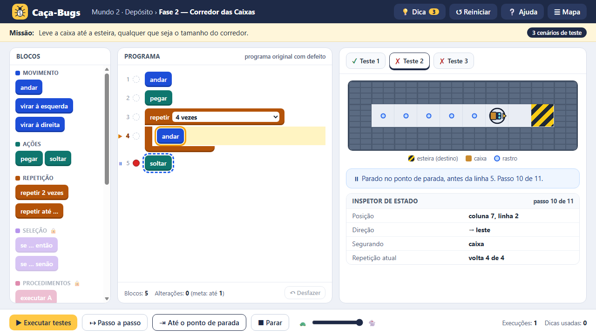

# Caça-Bugs

Jogo digital educacional para ensinar estudantes do **6º ao 9º ano** a **depurar programas em blocos**: encontrar, entender e corrigir erros de sequência, repetição, seleção, procedimentos e variáveis.

Os robôs da Fábrica Byte chegam com programas **com defeito**. Em cada fase, o estudante executa os testes, observa onde o robô falha, investiga com as ferramentas de depuração (passo a passo, pontos de parada e inspetor de estado) e conserta o programa. Como o mesmo programa precisa passar em **vários cenários de teste**, decorar um caminho não resolve: é preciso generalizar a solução. Cada tipo de erro consertado vai para o **Insetário**, um catálogo de bugs com explicação e exemplo.

Projeto final da disciplina **Informática na Educação**. Alinhado ao eixo Pensamento Computacional da BNCC Computação (Resolução CNE/CEB nº 1/2022).



---

## Como executar

O jogo não precisa de instalação, de internet nem de servidor.

1. Baixe ou copie a pasta `caca-bugs` inteira para o computador (se vier compactada em `.zip`, descompacte antes).
2. Abra o arquivo **`index.html`** com dois cliques. Ele abre no navegador padrão.
3. Clique em **Jogar**.

**Navegadores:** Google Chrome, Microsoft Edge ou Mozilla Firefox em versões atuais (funciona também em Chromebooks).
**Tela:** a partir de 1280 × 720 pixels.

O progresso (fases concluídas, estrelas e Insetário) fica salvo **no próprio navegador** do computador. Em computadores compartilhados, use o modo professor para apagar o progresso ao fim da aula.

### Opcional: servir por HTTP

Se preferir abrir por um endereço `http://`, qualquer servidor de arquivos estáticos funciona. Com Python instalado, dentro da pasta `caca-bugs`:

```bash
python -m http.server 8000
```

Depois, acesse `http://localhost:8000`. A pasta também pode ser publicada como está no GitHub Pages.

---

## Como jogar

| Ação | Como fazer |
|---|---|
| Executar os testes | Botão **▶ Executar testes** (ou `Ctrl+Enter`). A fase termina quando **todos** os cenários passam. |
| Executar bloco a bloco | **↦ Passo a passo** (ou `F10`). O bloco amarelo acabou de rodar; o de contorno azul é o próximo. |
| Pontos de parada (Mundo 2 em diante) | Clique no círculo ao lado do número da linha (ou selecione o bloco e tecle `B`) e use **⇥ Até o ponto de parada** (`F8`). |
| Parar a execução | **■ Parar** (ou `Esc`). O robô volta ao início. |
| Inspetor de estado | Aparece durante a depuração: posição, direção, carga, volta do laço, sensores (Mundo 3) e contador (Mundo 4). |
| Editar o programa | Arraste blocos da paleta para o programa; arraste-os para mudar de lugar; arraste para fora do programa para apagar. Os valores (direção, repetições, condição) ficam nas caixinhas brancas. |
| Editar pelo teclado | `Tab` chega aos blocos · `↑`/`↓` navegam · `Delete` apaga · `Alt+↑`/`Alt+↓` movem · `Alt+→` coloca dentro do bloco de cima · `Alt+←` tira de dentro · na paleta, `Enter` insere o bloco · `Ctrl+Z` desfaz. |
| Dicas | Botão **💡 Dica**: até 3 por fase (onde observar, onde procurar, tipo de bug), sem mostrar a solução. |
| Reiniciar | **↺ Reiniciar** devolve o programa original com defeito (dá para desfazer). |

**Estrelas:** ★ passar em todos os testes · ★ alterar no máximo o número de blocos da meta · ★ não usar dicas.

A primeira fase tem um **tutorial interativo**. O botão **❔ Ajuda** mostra o resumo dos controles a qualquer momento.

---

## Manual do professor

Na tela inicial, clique em **🎓 Modo professor** e digite o código de acesso **`professor`**.

No painel é possível:

- **liberar todas as fases** neste navegador, para trabalhar direto em um conteúdo (repetição, seleção...);
- **exportar o progresso** em `caca-bugs-progresso.csv` (situação, estrelas, execuções e dicas por fase; abre no Excel ou no LibreOffice);
- **apagar o progresso** deste navegador, útil em laboratórios com computadores compartilhados.

**Privacidade (LGPD):** o jogo não pede nome nem e-mail e não envia dados para a internet. O progresso fica apenas no navegador e só sai dele quando o professor exporta o arquivo.

### Conteúdo das fases

| Mundo | Conceito | Fase | Bug a consertar |
|---|---|---|---|
| 1 · Esteira de Montagem | Sequência | 1. Primeiros passos | Besouro da Ordem Trocada |
| | | 2. Curva na esteira | Grilo Canhoto |
| | | 3. Ida e volta | Formiga do Passo a Mais |
| 2 · Depósito | Repetição | 1. Caixa no fim do corredor | Formiga do Passo a Mais |
| | | 2. Corredor das Caixas | Lagarta da Contagem Fixa |
| | | 3. A esteira que não para | Cupim do Laço Infinito |
| 3 · Sala dos Sensores | Seleção | 1. Tem caixa aqui? | Barata da Condição Invertida |
| | | 2. Curva no corredor | Mosquito do Caso Esquecido |
| | | 3. Labirinto dos sensores | Traça do Escopo |
| 4 · Linha de Produção | Procedimentos e variáveis | 1. Montagem em série | Vespa do Procedimento |
| | | 2. Contando caixas | Joaninha do Contador |
| | | 3. Ninho de bugs | Besouro, Grilo e Lagarta juntos |

---

## Estrutura do projeto

```
caca-bugs/
├── index.html                  página do jogo (abre direto do disco)
├── css/estilo.css              aparência
├── js/
│   ├── nucleo/                 regras do jogo, sem interface (testadas no Node)
│   │   ├── base.js             constantes, sensores e condições
│   │   ├── mundo.js            mapa em grade, ações do robô, missão
│   │   ├── programa.js         blocos: editar, mover, contar alterações, validar
│   │   ├── interpretador.js    execução com rastro e limite de 1.000 passos
│   │   └── progresso.js        salvamento, liberação de fases, estrelas, CSV
│   ├── ui/                     interface
│   │   ├── editor.js           editor de blocos (arrastar e soltar, teclado)
│   │   ├── cena.js             desenho e animação do mapa
│   │   ├── fase.js             testes, depuração, dicas e conclusão da fase
│   │   ├── telas.js            início, mapa, Insetário, professor, relatório
│   │   ├── tutorial.js         tutorial da primeira fase
│   │   ├── janelas.js          janelas acessíveis
│   │   └── icones.js           ilustrações em SVG
│   └── app.js                  inicialização e navegação
├── dados/
│   ├── mundos.json             mundos e ordem das fases
│   ├── insetario.json          os 10 tipos de bug
│   ├── fases/m1f1.json …       uma fase por arquivo
│   └── dados.js                pacote gerado a partir dos JSON (não editar)
├── ferramentas/empacotar-dados.js
├── testes/                     testes automatizados (node:test)
└── package.json                comandos de desenvolvimento
```

O jogo não usa bibliotecas externas. O Node.js só é necessário para quem for **editar fases** ou **rodar os testes**.

---

## Criar ou alterar fases

As fases ficam em `dados/fases/*.json`, separadas do código. Cada arquivo descreve:

- `missao`, `titulo`, `mundo`, `numero`;
- `blocos` liberados (`andar`, `virar`, `pegar`, `soltar`, `repetir`, `se`, `chamar`, `definir`, `aumentar`), `sensores` e `ferramentas`;
- `cenarios`: um a quatro mapas em texto, com os símbolos `#` parede, `.` chão, `E` esteira, `C` caixa (`2`–`9` para pilhas) e `>` `<` `^` `v` para o robô e sua direção;
- `objetivo`: `{ "quantidade": "todas" }`, `{ "quantidade": 2, "exata": true }` ou com `"terminarSobre": "esteira"`;
- `programa` (com o bug) e `solucao` (referência usada só nos testes), em blocos com `id`;
- `metaAlteracoes`, as três `dicas`, os `bugs` da fase e a `explicacao` mostrada no relatório.

As condições são textos como `"sobreEsteira"`, `"!caminhoLivre"` (negação) ou `"contador<2"`.

Depois de editar, gere o pacote e rode os testes:

```bash
npm run empacotar
npm test
```

O comando `npm run empacotar` recria `dados/dados.js`, que o navegador carrega como script (páginas abertas direto do disco não podem ler arquivos `.json`). Os testes conferem, para **cada fase**, que o programa com defeito falha em algum cenário, que a solução passa em todos e que a correção cabe na meta de alterações.

## Testes automatizados

Requer Node.js 20 ou mais recente; não há dependências para instalar.

```bash
npm test
```

São 24 testes: mapa, ações e sensores do robô, interpretador (laços, condições, procedimentos, contador, limite de passos), edição de blocos e contagem de alterações, progresso e CSV, além da validação das 12 fases.

---

## Requisitos atendidos

| Requisito (Termo de Abertura) | Onde está |
|---|---|
| RF001 mapa de mundos com liberação progressiva | `js/ui/telas.js` (mapa), `js/nucleo/progresso.js` |
| RF002 fase com programa defeituoso e cenários | `dados/fases/*.json`, `js/nucleo/programa.js` |
| RF003 edição por arrastar e soltar | `js/ui/editor.js` |
| RF004 execução animada com destaque do bloco | `js/ui/cena.js`, `js/ui/fase.js` |
| RF005 resultado de cada cenário, motivo e passo | `js/nucleo/interpretador.js`, `js/ui/fase.js` |
| RF006 passo a passo | `js/ui/fase.js` |
| RF007 pontos de parada | `js/ui/editor.js`, `js/ui/fase.js` |
| RF008 inspetor de estado | `js/ui/fase.js` |
| RF009 conclusão só com todos os testes | `js/ui/fase.js` |
| RF010 três dicas graduais | `js/ui/fase.js`, campo `dicas` das fases |
| RF011 Insetário | `js/ui/telas.js`, `dados/insetario.json` |
| RF012 estrelas | `js/nucleo/progresso.js` |
| RF013 salvamento automático | `js/nucleo/progresso.js` |
| RF014 tutorial interativo | `js/ui/tutorial.js` |
| RF015 modo professor e CSV | `js/ui/telas.js` |
| RF016 reiniciar a fase | `js/ui/fase.js` |
| RNF001 navegador, sem instalação nem servidor | `index.html` com scripts clássicos |
| RNF002 / RNF003 offline e sem dados pessoais | sem bibliotecas externas; `localStorage` |
| RNF005 acessibilidade | edição completa pelo teclado, rótulos ARIA, ícone e texto além da cor |
| RNF007 limite de 1.000 passos | `CB.LIMITE_PASSOS` em `js/nucleo/base.js` |
| RNF008 fases em JSON | `dados/fases/`, `ferramentas/empacotar-dados.js` |

---

## Créditos

Projeto acadêmico de [Aluno(a) 1] e [Aluno(a) 2] para a disciplina Informática na Educação. Ilustrações em SVG feitas para o jogo.
